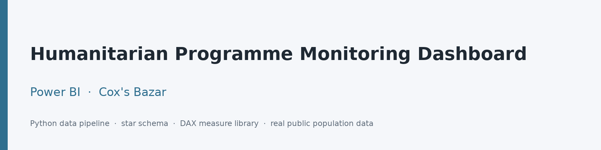
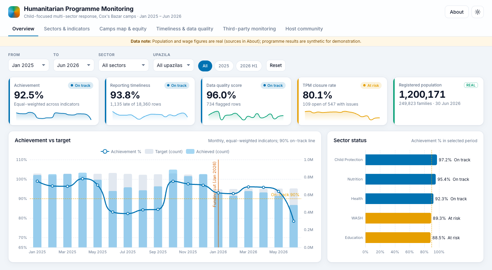
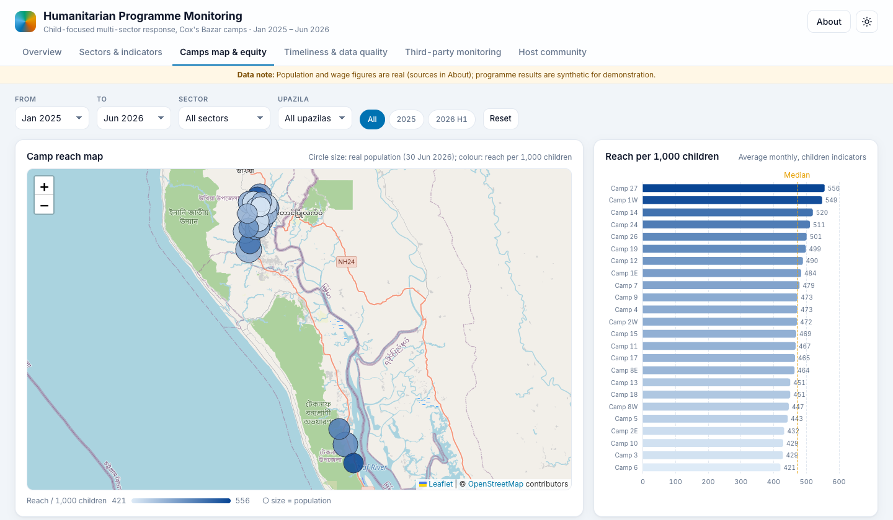
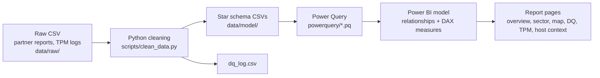

<p align="center"></p>

# Humanitarian Programme Monitoring Dashboard (Power BI)

<p align="center"><a href="https://takyurp09.github.io/powerbi-humanitarian-monitoring-dashboard/"><strong>▶ Open the interactive web dashboard</strong></a> &nbsp;·&nbsp; <a href="docs/CASE_STUDY.md">Read the case study</a></p>

> The repository holds the Power BI layer (Power Query scripts, DAX measures, report theme and page specification) and a working web dashboard in `site/`, built with ECharts and Leaflet on the same model data. Population and wage figures are real; programme results are synthetic.

[](https://github.com/takyurp09/powerbi-humanitarian-monitoring-dashboard/actions/workflows/validate.yml)


[](LICENSE)


A portfolio project that builds an end-to-end monitoring solution for a multi-sector, child-focused programme in a humanitarian response context. Python scripts clean messy partner reports and third-party monitoring (TPM) visit logs into a star schema. On top of that model, Power Query scripts and a documented DAX measure library define target achievement by sector, indicator and camp, reporting timeliness, data quality, equity by sex, and the follow-up of issues raised by third-party monitors. The repository also has a report theme, a page-by-page report specification and a web dashboard that runs on the same data.

**Case study:** [docs/CASE_STUDY.md](docs/CASE_STUDY.md) is an analytical brief that uses the dashboard to answer six monitoring questions after a 2026 funding cut (sector performance, camp coverage, reporting and data quality, TPM follow-up, sex gaps, host-community wages), with recommendations.

## At a glance
- **1,200,171 refugees** in the real GoB-UNHCR Joint Registration figures (30 Jun 2026) used to scale the model.
- **24 camps** modelled, with real population, families, upazila, union and coordinates.
- **15 indicators** across five sectors (Education, Child Protection, Health, Nutrition, WASH).
- **18 months** of monthly programme data (Jan 2025 to Jun 2026).

## Contents
- [Preview](#preview)
- [What it demonstrates](#what-it-demonstrates)
- [Skills demonstrated](#skills-demonstrated)
- [Architecture](#architecture)
- [Quick start](#quick-start)
- [Key metrics](#key-metrics)
- [Data](#data)
- [Roadmap](#roadmap)
- [Authorship and AI assistance](#authorship-and-ai-assistance)
- [Citation](#citation)
- [Licence](#licence)

## Preview

Screenshots from the [web dashboard](https://takyurp09.github.io/powerbi-humanitarian-monitoring-dashboard/).

<p align="center"></p>

*Overview page: achievement against target, reporting timeliness, data quality and TPM closure, with the January 2026 funding cut marked on the trend.*

<p align="center"></p>

*Camp map: circles are sized by the real camp population and coloured by reach per 1,000 children.*

Case-study charts (from [docs/CASE_STUDY.md](docs/CASE_STUDY.md)):

| | |
|---|---|
|  |  |
|  |  |

<details>
<summary>Power BI report pages</summary>

[docs/DASHBOARD_SPEC.md](docs/DASHBOARD_SPEC.md) sets out the visuals, filters and measures for each page, and [assets/wireframe.svg](assets/wireframe.svg) shows the overview layout. The web dashboard follows the first six pages.

1. Executive overview
2. Sector and indicator performance
3. Camp map and equity
4. Reporting timeliness and data quality
5. Third-party monitoring follow-up
6. Host community context
7. Camp detail (drill-through)

</details>

## What it demonstrates
- **Data modelling**: a star schema with conformed date, camp, sector, indicator and partner dimensions and two fact tables at different grains.
- **DAX**: a measure library organised in display folders, including mixed-aggregation achievement logic, status thresholds, time intelligence (MoM, YTD, same period last year, rolling three months) and dynamic titles.
- **Data quality**: rule-based cleaning of raw partner reports (name standardisation, date parsing, deduplication) with a cleaning log, plus in-report timeliness and quality scoring.
- **TPM follow-up**: closure rates, days to close and overdue follow-ups by partner, camp and issue category.
- **GIS**: a camp-level map visual with status colouring and drill-through to camp detail.
- **Host-community context**: real BBS agricultural wage series for Cox's Bazar against the national median, shown descriptively next to real camp population.

## Skills demonstrated

| Area | Evidence in this repository |
|---|---|
| Data modelling | Star schema with conformed dimensions and two fact tables ([docs/SCHEMA.md](docs/SCHEMA.md)) |
| DAX | Measure library with mixed aggregation, status thresholds and time intelligence ([dax/measures.dax](dax/measures.dax)) |
| Power Query (M) | One script per table, parameterised data folder ([powerquery/](powerquery/)) |
| Python data engineering | Ingest, synthetic generation, cleaning and validation ([scripts/](scripts/)) |
| Data quality | Rule-based cleaning with a cleaning log ([data/model/dq_log.csv](data/model/dq_log.csv)) |
| Report design | Page specification and theme ([docs/DASHBOARD_SPEC.md](docs/DASHBOARD_SPEC.md), [theme/report_theme.json](theme/report_theme.json)) |
| Analysis and writing | Analytical brief with recommendations ([docs/CASE_STUDY.md](docs/CASE_STUDY.md)) |
| Reproducibility | Makefile pipeline and GitHub Actions validation ([.github/workflows/validate.yml](.github/workflows/validate.yml)) |

## Architecture



<details>
<summary>Repository structure</summary>


```
.
├── assets/            Banner, wireframe, case-study charts and web dashboard screenshots
├── data/
│   ├── external/      Public source files (HDX, UNHCR) + SOURCES.md
│   ├── raw/           Messy synthetic inputs
│   └── model/         Cleaned star-schema tables
├── dax/measures.dax   DAX measure library
├── docs/
│   ├── SCHEMA.md            Data model contract
│   ├── DATA_DICTIONARY.md   Tables, columns, types
│   ├── DASHBOARD_SPEC.md    Page-by-page report specification
│   ├── CASE_STUDY.md        Analytical brief built on the dashboard
│   ├── case_study_tables/   Figures cited in the case study
│   └── BUILD_GUIDE.md       Steps to build the report in Power BI Desktop
├── powerquery/        Power Query (M) script per table
├── site/              Web dashboard (ECharts, Leaflet), deployed to GitHub Pages
├── scripts/           Population and wage ingest, data generation, cleaning, validation, case-study metrics (Python)
├── theme/report_theme.json  Power BI report theme
├── Makefile
└── LICENSE
```

</details>

## Quick start

```bash
python3 -m venv .venv && .venv/bin/pip install -r requirements.txt   # pdftotext (poppler) also required
make all        # ingest real population and wage data, generate synthetic raw data, clean, validate, case-study metrics
```

The ingest step skips with a message and keeps the committed CSVs when its external inputs are absent (the UNHCR PDF is not redistributed and the wage source sits outside the repository), so `make all` also runs on a fresh clone. Continuous integration runs `make data validate case-study`.

Then follow [docs/BUILD_GUIDE.md](docs/BUILD_GUIDE.md) to load the model into Power BI Desktop, import the measures, apply the theme and build the pages.

## Key metrics

<details>
<summary>Metric definitions</summary>


| Metric | Definition |
|---|---|
| Achievement % | SUM(achieved) / SUM(target) for count indicators; AVERAGE(achieved) / AVERAGE(target) for rate indicators; equal-weight average across indicators. |
| Status | On track >= 90%; at risk 70-89%; off track < 70%. |
| Reporting timeliness % | Share of result rows submitted by the 10th of the following month. |
| Data quality score % | Share of result rows with no data quality flag. |
| TPM closure rate | Closed follow-ups / visits that flagged at least one issue. |
| Average days to close | Mean days from visit to closure, over closed follow-ups of visits that flagged issues. |
| Coverage % / Reach per 1,000 children | Average monthly children reached relative to real camp children population. |
| Open follow-ups > 30 days | Open follow-ups from visits more than 30 days before the latest visit date. |
| Female share % | Female share of achieved beneficiaries (count indicators). |

Full definitions are in [docs/DATA_DICTIONARY.md](docs/DATA_DICTIONARY.md) and the comments of [dax/measures.dax](dax/measures.dax).

</details>

## Data
The model combines real public camp population data with synthetic programme data.

| Component | Real or synthetic | Source | Licence / terms | As of |
|---|---|---|---|---|
| Camp list, upazila, union, coordinates (`dim_camp`, `dim_camp_population_2021`) | Real | HDX / ISCG, RRRC-UNHCR family counting ([dataset](https://data.humdata.org/dataset/site-location-of-rohingya-refugees-in-cox-s-bazar)) | CC0 | 31 Oct 2021 |
| Camp population and families (`dim_camp[population]`, `ref_population_2026`) | Real | Government of Bangladesh - UNHCR Joint Registration, population dashboard ([PDF](https://data.unhcr.org/en/documents/download/123174)) | Public UNHCR document, reused with attribution | 30 Jun 2026 |
| Age/sex demographics, children share (`ref_demographics_2026`, `dim_camp[children_share]`) | Real (national share applied to each camp) | Same UNHCR dashboard | As above | 30 Jun 2026 |
| Host-community agricultural wages, Cox's Bazar and national median (`ref_wages_coxsbazar`) | Real | BBS Agricultural Wage Statistics, public download ([bbs.gov.bd](http://www.bbs.gov.bd/)); derived from the author's research pipeline (`scripts/ingest_wages.py`) | Public government statistics, reused with attribution | 2017-01 to 2025-12 |
| Programme targets and results (`fact_results`) | Synthetic; count targets scaled to real camp (children) population | `scripts/generate_data.py`, seed 2026 | MIT (this repo) | 2025-01 to 2026-06 |
| Partners, indicators, TPM visits (`dim_partner`, `dim_indicator`, `fact_tpm_visits`) | Synthetic | `scripts/generate_data.py` | MIT (this repo) | 2025-01 to 2026-06 |

Source: Government of Bangladesh-UNHCR Joint Registration, 30 Jun 2026; BBS Agricultural Wage Statistics (derived by the author). Full provenance is in [data/external/SOURCES.md](data/external/SOURCES.md). The synthetic programme data do not represent any organisation's real results.

## Roadmap
- [x] Data pipeline, Power Query scripts, DAX measure library, theme and documentation
- [x] Case study with figures and recommendations
- [x] Continuous integration for the data pipeline
- [x] Web dashboard on GitHub Pages

See [CHANGELOG.md](CHANGELOG.md) for released changes and [CONTRIBUTING.md](CONTRIBUTING.md) for how to report issues.

## Authorship and AI assistance
Designed and maintained by Muhammad Taky Tahmid. The data pipeline, DAX measure library, web dashboard and documentation were developed with AI assistance (Claude).

- GitHub: [takyurp09](https://github.com/takyurp09)

## Citation
If you use this project, please cite it via [CITATION.cff](CITATION.cff):

```bibtex
@software{tahmid_2026_humanitarian_dashboard,
  author  = {Tahmid, Muhammad Taky},
  title   = {Humanitarian Programme Monitoring Dashboard (Power BI)},
  version = {1.0.0},
  year    = {2026},
  url     = {https://github.com/takyurp09/powerbi-humanitarian-monitoring-dashboard}
}
```

## Licence
Released under the [MIT Licence](LICENSE).
