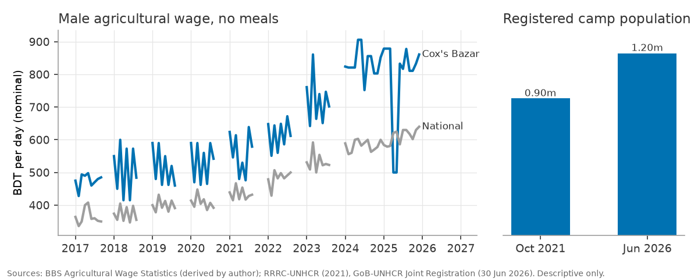
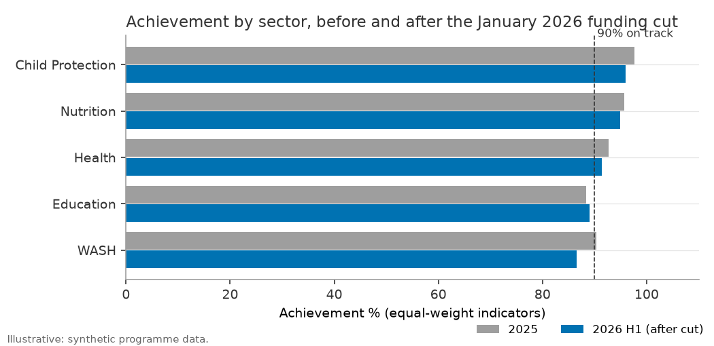
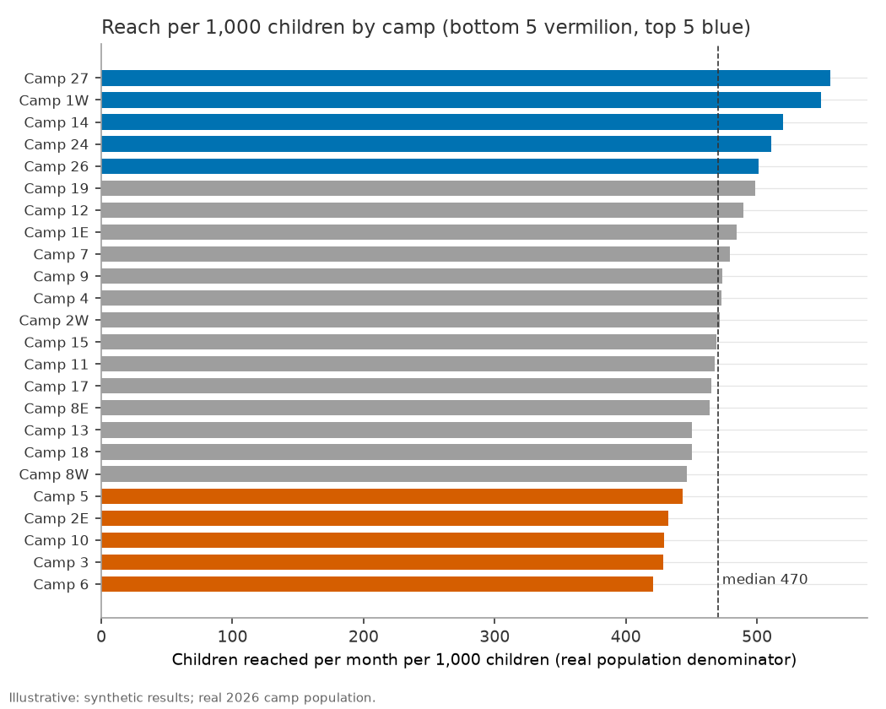
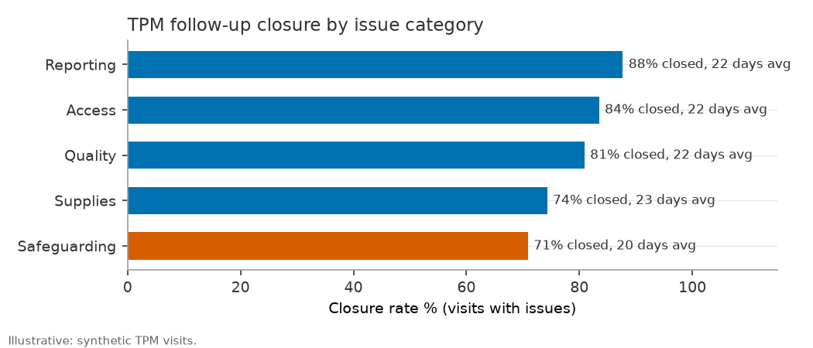

# Case study: monitoring a child-focused programme after the 2026 funding cut

*An analytical brief written from the point of view of a planning, monitoring and information management officer in the Cox's Bazar refugee response. Prepared with the dashboard in this repository.*

> **Read this first.** Population figures are real (Government of Bangladesh – UNHCR Joint Registration, 30 Jun 2026; HDX/RRRC-UNHCR, 31 Oct 2021). Host-community wages are real (BBS Agricultural Wage Statistics, derived by the author). **All programme results, partners, reporting dates and third-party monitoring (TPM) visits are synthetic.** Programme findings below show how the analysis works. They are illustrative and say nothing about any real organisation's performance.

Every number in this brief is produced by [`scripts/case_study_metrics.py`](../scripts/case_study_metrics.py), which writes the tables in [`docs/case_study_tables/`](case_study_tables/) and the charts in `assets/`. Run `make all` to rebuild them.

## 1. Context

### The camp population

As of 30 June 2026, 1,200,171 Rohingya refugees in 249,823 families were registered in the camps of Ukhia and Teknaf upazilas and on Bhasan Char. Children under 18 make up 52.0% of that population (623,895 people), and women and girls 51.5%. The five largest camps are Camp 15 (67,535), Camp 26 (56,266), Camp 1E (53,703), Camp 13 (53,549) and Camp 7 (48,580). *Source: Government of Bangladesh – UNHCR Joint Registration, 30 Jun 2026.*

For comparison, the RRRC-UNHCR family counting recorded 901,703 people across 34 sites in October 2021. The two sources use different methods, so the difference should not be read as a precise growth figure, but the population the response serves is large, young and has not shrunk.

The dashboard covers the 24 most populous camps that also have a public site location. Together they hold 994,724 people, about 83% of the registered total. Child population per camp is estimated by applying the national under-18 share (52.0%) to each camp's real population, because camp-level age breakdowns are not published in the same dashboard.

### The host district

Cox's Bazar is also a host district with its own labour market. The BBS Agricultural Wage Statistics give a monthly daily wage by district, sex and meals provided. For male workers paid without meals, the Cox's Bazar median rose from 480 taka a day in 2017 to 833 taka in 2025, against a national median of 358 and 620 taka. The district premium over the national median stayed in a band of roughly 26% to 42% for men across the period. For women it narrowed from 38% in 2017 to 8% in 2025, when the Cox's Bazar median was 479 taka against 444 nationally. Wages are nominal and are not adjusted for inflation.

These figures are context. They show the cost environment partners work in (casual labour, volunteers, local procurement), and they help explain why host-community concerns come up in coordination meetings. They do not show that the refugee presence raised or lowered wages, and this brief makes no such claim.

### The funding cut

In the scenario modelled here, programme budgets were cut from January 2026. Partners lowered count targets by about a fifth and expected delivery quality to slip a little. The rest of this brief asks what the monitoring system can tell managers six months later.

## 2. Monitoring questions

1. **Are sectors on track after the 2026 funding cut?** Which sectors and indicators have fallen below the 90% threshold since January?
2. **Which camps lag on coverage?** Measured as children reached per month per 1,000 children, using the real population as denominator.
3. **Is reporting timely, and can we rely on the data?** How do partners compare on timeliness and data quality, and which quality problems are most common?
4. **Do TPM findings get closed?** What share of issues are followed up, how long it takes, and which categories are left open.
5. **Are there gaps by sex?** Is the female share of people reached in line with the population (51.5% female), and do any camps fall well below it?
6. **What is happening in the host district?** A descriptive look at wages to inform host-community programming and staffing budgets.

## 3. Data and methods

### Model

The data sit in a star schema (see [SCHEMA.md](SCHEMA.md)). Two fact tables hold monthly results (`fact_results`, one row per month, camp, indicator, partner and sex; 18,360 rows) and TPM visits (`fact_tpm_visits`, 900 visits). They share conformed dimensions for date, camp, sector, indicator and partner. Real reference tables (`ref_population_2026`, `ref_demographics_2026`, `dim_camp_population_2021`, `ref_wages_coxsbazar`) are kept disconnected so they cannot change programme totals by accident.

### Cleaning

Raw partner reports come in with the usual problems. `scripts/clean_data.py` fixes them by rule and records each rule in `dq_log.csv`:

| Rule | Rows affected |
|---|---:|
| Camp names standardised (e.g. "camp-1e", "Camp 1 E") | 5,598 |
| Non-ISO report dates parsed | 9,265 |
| Sex codes expanded (F/M) | 910 |
| Exact duplicate rows removed | 184 |
| Missing achieved values flagged | 275 |
| Inconsistent values (negative, rates over 100%) flagged and blanked | 280 |
| Outliers flagged (achieved more than 2.5 times target) | 179 |
| Late reports flagged | 1,135 |
| TPM: duplicate visits removed / camp names fixed / category case fixed | 12 / 280 / 21 |

Flagged rows stay in the model so they can be counted, but blanked values are left out of achievement.

### Definitions

- **Achievement %**: for count indicators, sum of achieved over sum of target; for rate indicators, mean over mean. When several indicators are in view they are averaged with equal weight, so a large count indicator does not swamp a small one.
- **Status**: on track at 90% or more, at risk from 70% to 89%, off track below 70%.
- **Reach per 1,000 children**: average monthly achieved on children-unit count indicators, divided by the camp's child population, times 1,000.
- **Reporting timeliness %**: share of result rows submitted by the 10th of the following month.
- **Data quality score %**: share of result rows with no quality flag.
- **TPM closure rate**: closed follow-ups over visits that flagged at least one issue. Days to close are averaged over closed follow-ups only.

### What is real and what is not

Camp names, locations, population and the age/sex profile are real. So are the wage figures. Partners, indicators, targets, results, reporting dates and TPM visits are synthetic, generated with a fixed seed. Count targets are scaled to real camp population so that the coverage ratios are of a believable size. The patterns in Section 4 come from the way the synthetic data were generated, including the January 2026 cut. They are there to show the method.

## 4. Findings

*Programme findings in this section are illustrative (synthetic data). Population and wage figures are real.*

### 4.1 Sector performance after the cut

Overall achievement fell from 93.0% in 2025 to 91.6% in the first half of 2026, while monthly count targets fell by 18% to 19% in every sector. Lower targets did not lead to higher achievement. Partners delivered less, and slightly more slowly, than the lower targets assumed.

| Sector | 2025 | 2026 H1 | Change (points) | Monthly target change |
|---|---:|---:|---:|---:|
| WASH | 90.4% | 86.6% | -3.9 | -19.1% |
| Education | 88.4% | 89.0% | +0.6 | -19.1% |
| Health | 92.7% | 91.4% | -1.3 | -18.7% |
| Nutrition | 95.7% | 94.9% | -0.8 | -19.3% |
| Child Protection | 97.7% | 96.0% | -1.7 | -18.0% |

WASH had the largest drop and moved from on track to at risk. Education was already below 90% in 2025 and stayed there. No indicator was off track (below 70%) in 2026 H1, but five were at risk. The weakest was *people with access to safe water*, down from 92.4% to 83.6%. It was followed by *learning centre attendance rate* (84.4%), *hygiene kits distributed on time* (85.0%), *children enrolled in learning centres* (88.1%) and *outpatient consultations* (88.7%).

### 4.2 Coverage by camp

Across the 24 camps, median reach was 470 per 1,000 children per month. Because the measure adds up several children indicators, it is a relative index for comparing camps, and it should not be read as a share of children.

| Top 5 camps | Reach per 1,000 | | Bottom 5 camps | Reach per 1,000 |
|---|---:|---|---|---:|
| Camp 27 (Teknaf) | 556 | | Camp 5 (Ukhia) | 443 |
| Camp 1W (Ukhia) | 549 | | Camp 2E (Ukhia) | 433 |
| Camp 14 (Ukhia) | 520 | | Camp 10 (Ukhia) | 429 |
| Camp 24 (Teknaf) | 511 | | Camp 3 (Ukhia) | 429 |
| Camp 26 (Teknaf) | 501 | | Camp 6 (Ukhia) | 421 |

All five lagging camps are in Ukhia, and three of the five leaders are in Teknaf. The gap between Camp 27 and Camp 6 is about 32%. Achievement against target in the bottom five is still close to 90% (88.7% to 92.6%). Those camps hit most of their targets; the targets themselves were set low relative to the number of children. That is a planning question as much as a delivery one.

### 4.3 Timeliness and data quality

Reporting timeliness was 93.8% overall, with 1,135 late rows, and it did not change after the cut. Partners sat in a narrow range, from Partner J (92.9%, government) and Partner G (93.0%, national NGO) to Partner F (94.7%, international NGO). Average lag from the start of the reporting month to submission was about 35 days for everyone. With differences this small, ranking partners publicly would be unfair. The more useful approach is to watch for any partner that drops below 90% in a given month.

The data quality score was 96.0%. Of 734 flagged rows, 280 were inconsistent (negative values or rates over 100%), 275 had a missing achieved value and 179 were outliers. Partner H had the lowest quality score (94.6%) and Partner D the highest (96.7%). Inconsistent and missing values together make up 75% of flags, and both could be blocked at the point of entry.

### 4.4 Third-party monitoring follow-up

Of 900 TPM visits, 547 flagged at least one issue. The average visit rating was 2.95 on a four-point scale. Partners closed 80.1% of follow-ups, taking 22.0 days on average, and 95 follow-ups were still open more than 30 days after the visit.

| Issue category | Visits with issues | Closure rate | Avg days to close | Open > 30 days |
|---|---:|---:|---:|---:|
| Safeguarding | 55 | 70.9% | 19.5 | 15 |
| Supplies | 101 | 74.3% | 23.0 | 23 |
| Quality | 209 | 80.9% | 22.2 | 35 |
| Access | 109 | 83.5% | 22.0 | 14 |
| Reporting | 73 | 87.7% | 22.0 | 8 |

Safeguarding is the category that matters most here. It has the lowest closure rate. The safeguarding cases that do close are the fastest to close, which suggests some are handled quickly and others stall. Quality issues are the most common and leave the most items overdue (35).

### 4.5 Sex

Women and girls made up 52.1% of people reached on count indicators, close to their 51.5% share of the population. By sector the share ranged from 51.7% (WASH) to 52.9% (Health). The camp-level view is less even. The female share ran from 44.4% in Camp 6 to 57.5% in Camp 1W, and Camp 6 is the only camp under the 45% alert line. Camp 6 is also the lowest on reach per 1,000 children, so it should be the first camp to review.

## 5. Recommendations

1. **Review indicators and targets after the cut.** Targets fell by about a fifth, yet achievement still slipped. Sector leads should confirm whether WASH water access and the two education indicators are under-delivered or were set with pre-cut assumptions. Where activities have stopped, retire or re-baseline the indicator instead of reporting persistent shortfalls.
2. **Re-set targets for the lagging camps.** For Camp 6, Camp 3, Camp 10, Camp 2E and Camp 5, compare targets with the real 2026 child population. They meet their targets but reach fewer children per 1,000. Raise the targets, or explain why lower coverage is acceptable there (for example, another actor covers the gap).
3. **Follow up TPM findings by category.** Track open safeguarding follow-ups individually at the monthly coordination meeting, with a named focal point and a 14-day target. Ask partners with Quality and Supplies items open past 30 days for a written action plan.
4. **Support partner reporting.** Timeliness is uniform, so blanket warnings will achieve little. Send a reminder on the 5th of each month, and contact a partner directly when it falls below 90% in any month. Pair the two weakest-scoring partners on data quality with a short refresher on the reporting template.
5. **Add data quality rules at entry.** Block negative values and rates over 100%, require a value or a reason code for blank cells, and use a drop-down for camp names. These steps would remove most of the 734 flagged rows and most of the 5,598 name fixes in the cleaning log.
6. **Look at Camp 6 as a whole.** It is lowest on coverage and lowest on female share. A short joint visit with the camp-in-charge office and the protection sector would show whether this comes from access, how activities are designed, or data entry.

## 6. How the dashboard supports this

| Question | Dashboard page | Main measures |
|---|---|---|
| Sectors on track after the cut | 1 Executive overview; 2 Sector and indicator performance | `[Achievement %]`, `[Status Label]`, `[Achievement % MoM Change]`, `[Achieved Same Period Last Year]`, `[Indicators off track]` |
| Camps lagging on coverage | 3 Camp map and equity; Camp detail drill-through | `[Reach per 1,000 children]`, `[Coverage %]`, `[Children Population]`, `[Camps off track]` |
| Timeliness and data reliability | 4 Reporting timeliness and data quality | `[Reporting Timeliness %]`, `[Late Reports]`, `[Avg Reporting Lag (days)]`, `[DQ Score %]`, `[DQ Issues - Missing]`, `[DQ Issues - Outlier]`, `[DQ Issues - Inconsistent]`, `dq_log` |
| TPM follow-up | 5 Third-party monitoring follow-up | `[Closure Rate]`, `[Avg Days to Close]`, `[Open Follow-ups > 30 days]`, `[Safeguarding Issues]` |
| Sex gaps | 3 Camp map and equity | `[Female share %]` (orange below 45%) |
| Host-community context | 6 Host community context | `[Host Wage (median daily, BDT)]`, `[Wage YoY %]`, `[Host vs national wage gap %]`, `[Camp Population (real)]` |

The period slicer lets a reader set 2025 against 2026 H1 directly. Every page carries `[Data Note]`, so the synthetic status of programme data is visible wherever a screenshot ends up.

## 7. Limitations

- **Synthetic programme data.** Results, partners and TPM visits are simulated. The cut, the sector gaps and the Camp 6 pattern come from the generator, not from field reports.
- **Child population is estimated.** The national under-18 share is applied to every camp. Camps with younger or older populations will look worse or better than they are.
- **Reach per 1,000 double counts.** It adds together several children indicators, so a child counted under enrolment and under screening appears twice. Use it to compare camps and read `[Coverage %]` one indicator at a time.
- **Population snapshots differ in method.** The 2021 family counting and the 2026 joint registration are not a consistent series.
- **Wages are nominal, and some months are missing.** BBS did not publish every month for every district, and the series is not deflated. The wage page is descriptive only and supports no causal claim about the refugee presence.
- **Equal weighting is a choice.** Averaging indicators with equal weight treats a facilities indicator the same as a people indicator. A weighted index would give different sector rankings.
